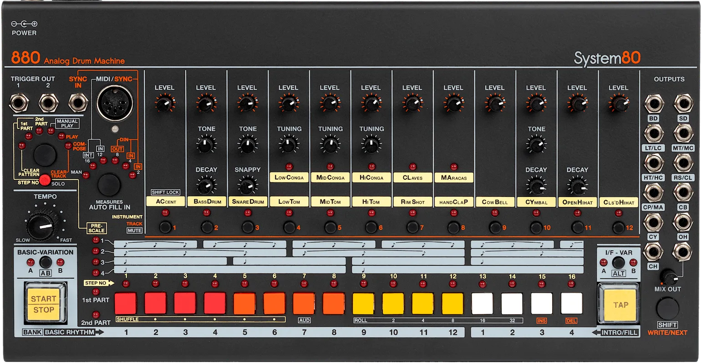

# 880 Perform – Bedienungsanleitung

Firmware für die **System80 880 Desktop (MK2)**, die live mit einer Hand gespielt werden kann. Basis ist die Original-Firmware 1.1.5 von minisystem.

> **Status:** Alle Funktionen sind umgesetzt, sie lassen sich bauen und sind automatisch getestet, **aber noch nicht am Gerät ausprobiert** (🧪). Vor dem ersten Live-Einsatz bitte die [Test-Checkliste](TEST-CHECKLISTE.md) abarbeiten.
> Interaktive Übersicht mit Klick auf das Panel: https://claude.ai/artifact/YR8iXaFYWAgP2C39WFYmb2

*Foto: System80, 880 Desktop*

**Tastennamen in dieser Anleitung**
- **Instrument 1–12**: die runden Tasten unter den Reglern. 1 = ACCENT, 2 = BD … 12 = CH.
- **Step 1–16**: die farbigen Tasten unten.
- **SHIFT** = WRITE/NEXT (rechts unten).
- **I/F-VAR** = Taste rechts über TAP. Gedrückt halten heißt auch **ALT**.
- **BASIC-VAR** = BASIC-VARIATION (links über START/STOP).
- **MODE** = große runde Taste oben links.
- **CLEAR** = kleine rote Taste darunter.

**Klick oder halten**
- **Klick** heißt: kurz drücken und loslassen, ohne eine andere Taste dazu.
- **Halten + Taste** heißt: Taste gedrückt halten und die zweite Taste dazu drücken.

---

## Schnellstart

| Was | Wie |
|---|---|
| Zwischen EDIT (Steps programmieren) und PERFORM (live spielen) wechseln | **MODE** |
| Pattern wählen | **BASIC-VAR klicken**, dann **Step 1–12** |
| Bank wählen | **BASIC-VAR halten + Step 1–12** |
| Instrument muten (PERFORM) | **Instrument 2–12** |
| Alle Mutes aufheben (PERFORM) | **Instrument 1** |
| Step-Loop (PERFORM) | **Step halten** (mehrere halten = laufen nacheinander) |
| Fill im nächsten Takt (PERFORM) | **TAP** |
| Live aufnehmen an/aus (PERFORM) | **I/F-VAR halten + TAP** |
| Pattern auf den Stand beim Auswählen zurücksetzen | **SHIFT + TAP** |
| Ratchet / Odds eines Steps (EDIT) | **Step halten + TAP** / **Step halten + SHIFT** |

---

## Modi

| Funktion | Tasten | Hinweis |
|---|---|---|
| EDIT ↔ PERFORM | **MODE** | Pattern, Takt und Mutes laufen nahtlos weiter, es wird nichts geladen. |
| 1st ↔ 2nd PART (in EDIT) | **I/F-VAR halten + MODE** | Ein leerer 2nd PART wird mit dem 1st PART gefüllt. Ohne Änderung wieder raus = Kopie wird verworfen. |
| PATTERN CLEAR an/aus | **SHIFT + MODE** | Nur für „alle Patterns löschen“, Versionsanzeige und DIN-Reset. |

**LEDs bei MODE:**
- 1st/2nd PART = EDIT
- MANUAL PLAY = PERFORM
- PLAY = Pattern-Ebene ist aktiv
- COMPOSE = Aufnahme läuft
- CLEAR PATTERN = PATTERN CLEAR

Der Song-Modus ist entfernt.

---

## Patterns, Banks, Variationen (EDIT und PERFORM)

| Funktion | Tasten | Hinweis |
|---|---|---|
| Pattern-Ebene ein/aus | **BASIC-VAR klicken** | Die Step-Tasten 1–12 sind jetzt Pattern-Tasten. |
| Pattern wählen | Pattern-Ebene: **Step 1–12** | Läuft der Sequencer, wechselt es am Ende des Patterns, sonst sofort. Das wartende Pattern blinkt. |
| Bank wählen | **BASIC-VAR halten + Step 1–12** | Wechselt zusammen mit dem Pattern. |
| Variation A → AB → B | **SHIFT + BASIC-VAR** | |
| Intro/Fill-Variation A/B | **I/F-VAR halten + BASIC-VAR** | |
| Fill-Pattern wählen bzw. Pattern 13–16 bearbeiten | EDIT, Pattern-Ebene: **Step 13–16** | |
| Pattern wählen bei Stop | EDIT: **Step 1–16**, PERFORM: **Step 1–12** (13–16 = Fill-Pattern) | |
| Abspielrichtung | **I/F-VAR halten + Step 13 / 14 / 15 / 16** | vorwärts / rückwärts / Ping-Pong / zufällig, wird mit dem Pattern gespeichert |
| Reload | **SHIFT + TAP** | Stand beim letzten Auswählen. Läuft der Sequencer, passiert das am Taktende. Wirkt nicht während eines Fills. |

---

## PERFORM

### Instrument-Tasten
**I/F-VAR klicken** wechselt zwischen **MUTE** (LED A neben I/F-VAR) und **AUSWAHL** (LED B).

| Funktion | Tasten |
|---|---|
| Mute an/aus (Tom und Conga, RS und CL, CP und MA immer zusammen) | MUTE: **Instrument 2–12** (gemutete leuchten) |
| Alle Mutes und Solo aufheben | MUTE: **Instrument 1** |
| Instrument wählen (zum Steps setzen) | AUSWAHL: **Instrument 1–12** |
| Solo an/aus | **CLEAR halten + Instrument** |
| Low/Mid/Hi **Tom** spielen | **I/F-VAR halten + Instrument 4 / 5 / 6** |
| Low/Mid/Hi **Conga**, Claves, Maracas spielen | **SHIFT halten + Instrument 4 / 5 / 6 / 7 / 8** |

### Step-Tasten
**SHIFT klicken** wechselt zwischen **LOOP** und **STEPS SETZEN**. Beim Wechsel nach PERFORM ist LOOP aktiv.

| Funktion | Tasten | Hinweis |
|---|---|---|
| Step-Loop | LOOP: **Step halten** | wiederholt in 16teln; mehrere gehaltene Steps laufen in Step-Reihenfolge; Loslassen = nahtlos weiter |
| Step setzen / löschen | STEPS SETZEN: **Step 1–16** | für das gewählte Instrument, im gerade spielenden Part |
| Shuffle | **SHIFT halten + Step 1–6** | |
| Fill im nächsten Takt | **TAP** | Stopp: TAP schaltet das Intro um |

### Pattern-Ebene (BASIC-VAR klicken)

| Funktion | Tasten | Hinweis |
|---|---|---|
| Pattern wählen | **Step 1–12** | beendet eine Kette |
| Kette | **Pattern halten + zweites Pattern drücken** | spielt vom ersten bis zum zweiten Pattern im Kreis, nur in PERFORM |
| Mute-Szene abrufen | **Step 13–16** | |
| Mute-Szene speichern | **SHIFT halten + Step 13–16** | |
| Pattern kopieren | **SHIFT halten + Quelle**, dann **SHIFT halten + Ziel** | Quelle blinkt; Bankwechsel dazwischen erlaubt; Quelle nochmal = Abbruch |
| Pattern löschen | **CLEAR halten + Pattern zweimal drücken** | |

### Aufnahme

| Funktion | Tasten | Hinweis |
|---|---|---|
| Aufnahme an/aus | **I/F-VAR halten + TAP** | COMPOSE-LED blinkt |
| Einspielen | **Instrument 1–12** (auch Toms/Congas wie oben) | gerundet auf den nächsten 16tel; während der Aufnahme spielen die Instrument-Tasten immer, egal welche Ebene |

Gespeichert wird **immer automatisch am Taktende**.

---

## EDIT

| Funktion | Tasten | Hinweis |
|---|---|---|
| Instrument wählen | **Instrument-Taste** | wie bisher (inkl. Tom/Conga-Umschaltung durch erneutes Drücken) |
| Step setzen | **Step drücken** | sofort |
| Step löschen | **gesetzten Step drücken und loslassen** | gelöscht wird beim Loslassen |
| Accent | **Instrument 1**, dann Steps | |
| Ratchet 1× → 2× → 3× → 4× | **gesetzten Step halten + TAP** | Anzeige: PRE-SCALE-LEDs (leuchtet) |
| Odds: jeder 1./2./3./4. Durchlauf | **gesetzten Step halten + SHIFT** | Anzeige: PRE-SCALE-LEDs (blinkt) |
| Tap-Write | **TAP** im Takt | wird auf den nächsten 16tel gerundet |
| Pattern-Länge (gilt für beide Parts) | **CLEAR halten + Step** im 1st PART | |
| 2nd PART entfernen | **CLEAR halten + Step 1** im 2nd PART | |
| Aktuelles Instrument löschen | **CLEAR klicken** | |
| Ganzes Pattern löschen | **CLEAR zweimal kurz** | |
| Shuffle | **SHIFT halten + Step 1–6** | |
| Mute an/aus | **SHIFT halten + Instrument** | |
| Alle Mutes aufheben | **CLEAR + Instrument 1** | |
| Solo | **CLEAR + Instrument** | wie bisher |

Die PRE-SCALE-LEDs sind sonst aus, die Auflösung ist fest. Odds und Ratchets: höchstens **31 Steps pro Pattern** (beide Parts und Variationen zusammen). Ist die Liste voll, blinken die Steps kurz.

---

## Einstellungen (Sequencer gestoppt)

| Funktion | Tasten |
|---|---|
| Sync-Modus | **SHIFT + AUTO FILL IN** (wie bisher) |
| Sync-Modus speichern | **I/F-VAR + AUTO FILL IN** |
| MIDI-Kanal | EDIT: **SHIFT + I/F-VAR halten + Step 1–16** |
| DIN-Sync-Teiler (DIN Slave) | EDIT: **SHIFT + Step 1–6** |
| DIN-Reset an/aus | PATTERN CLEAR: **SHIFT + Step 8** |
| Alle Patterns löschen | PATTERN CLEAR, gestoppt: **CLEAR halten + TAP zweimal** |
| Version anzeigen | PATTERN CLEAR: **SHIFT + TAP halten** (zeigt 1.1.6) |

**TRIGGER OUT 1** feuert mit dem **Low Tom**, **TRIGGER OUT 2** mit der **Low Conga**. Mute, Odds und Ratchets gelten auch für die Ausgänge.

---

## Was gegenüber der Original-Firmware weggefallen ist

- Song-Modus (PLAY/COMPOSE RHYTHM, INS/DEL); Ersatz ist die Kette
- 32tel-Zwischenschläge (2nd PART ohne Länge); der 2nd PART ist jetzt immer so lang wie der 1st PART
- Roll-Modus (SHIFT + Step 9–14); Ersatz ist der Step-Loop
- AUD Live-Hits; Ersatz ist die PERFORM-Aufnahme
- Trigger-Eingänge (TII) und frei wählbare Trigger-Zuweisung
- Pre-Scale-Wahl (SHIFT + CLEAR): Die Auflösung ist fest auf PRE-SCALE 3 (16tel im 4/4-Takt). Patterns mit anderem Pre-Scale spielen in dieser Auflösung und werden beim nächsten Speichern so abgelegt.
- Shift-Lock (SHIFT + ACCENT)
- Step-Fill (SHIFT + TAP), Instrument löschen mit CLEAR + TAP, Variation A→B kopieren (CLEAR + BASIC-VAR)
- Pattern-Kopieren bei Stop mit CLEAR + Step; Ersatz ist das neue Kopieren in PERFORM

**Achtung beim Zurückspielen der Original-Firmware:**
- **Songs:** Gespeicherte Songs sind nicht mehr da. Der Reload-Speicher liegt im ehemaligen Song-Bereich.
- **Patterns:** Patterns mit 32tel-Zwischenschlägen oder anderer 2nd-PART-Länge werden beim nächsten Speichern angepasst. Das ist dauerhaft.
- **Odds, Ratchets, Abspielrichtung:** Sie liegen in einem eigenen Speicherbereich, die Original-Firmware ignoriert sie.
